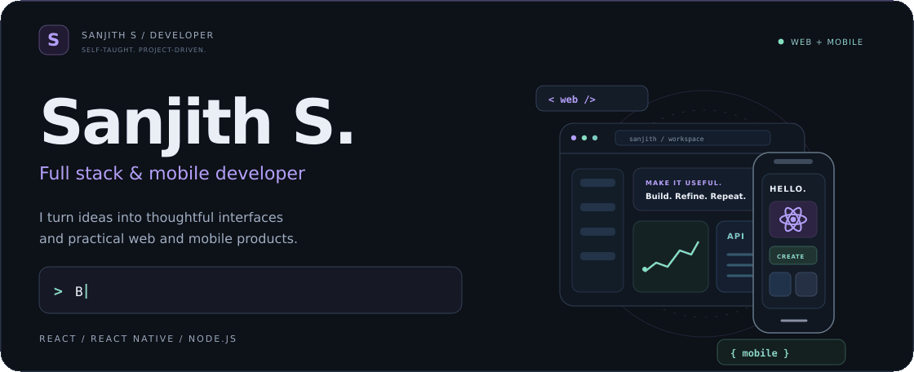
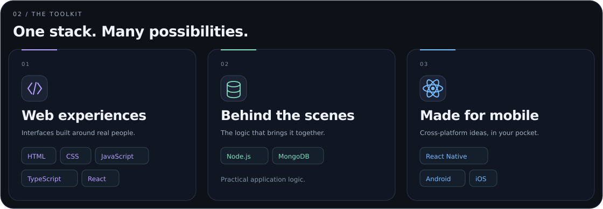
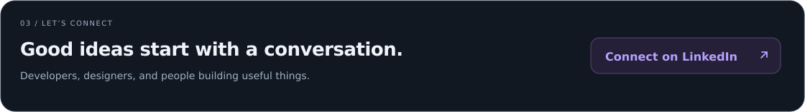

  <picture>
    <source media="(max-width: 640px)" srcset="./assets/hero-mobile.gif" />
    
  </picture>

 

<table width="100%">
  <tr>
    <td>
      01 / ABOUT ME
      <h3>Curious by nature. A developer by practice.</h3>
      
I'm a full stack developer who enjoys turning ideas into useful web and mobile products. My skills have grown through self-study, practical experience, and a curiosity for how things work.

      
I build with <b>React, Node.js, MongoDB, and React Native</b>, with a focus on thoughtful interfaces and practical problem solving.

      
<code>Learn by building</code> &nbsp; <code>Keep improving</code> &nbsp; <code>Make it useful</code>

    </td>
  </tr>
</table>

 

<picture>
  <source media="(max-width: 640px)" srcset="./assets/skills-mobile.svg" />
  
</picture>

  

<a href="https://www.linkedin.com/in/sanjith-s-491b51291/">
  <picture>
    <source media="(max-width: 640px)" srcset="./assets/contact-mobile.svg" />
    
  </picture>
</a>

 

Always learning. Always building.

